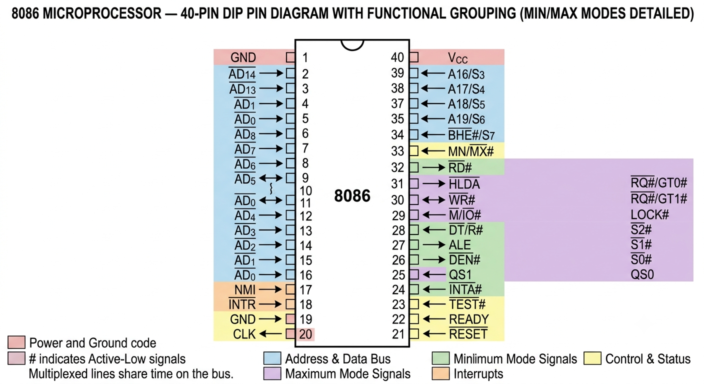
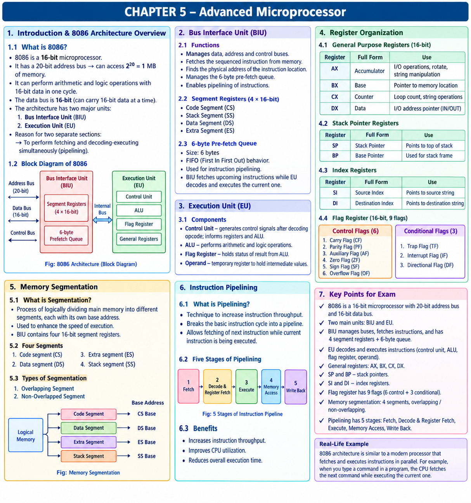

# LJ-MIT-sem3-chapter5-explained

---

# MIT — Chapter 5: Advanced Microprocessor

I’ve received your PPT, MIT_CH-5_Advanced Microprocessor.pptx, and identified its main topics. I’ll follow the slide order and use your PPT as the primary source, preserving its terminology and distinguishing any clarification from additional standard knowledge.

The chapter covers:

1. Details of 8086 architecture
    
2. Bus Interface Unit (BIU)
    
3. Execution Unit (EU)
    
4. Register organization and general-purpose registers
    
5. Stack pointer and index registers
    
6. Flag register
    
7. Memory segmentation
    
8. Instruction pipelining
    

We’ll follow your requested workflow in order: deep explanation, text-based mind map, mind map image, MCQs, 1-mark questions, 2-mark questions, 3-mark questions, 4/5-mark questions, and the final coverage checklist. When you type “next”, I’ll continue from where we stopped.

# STEP 1 — Deep Explanation

## 1. Details of 8086 Architecture

### 1.1 What is the 8086 microprocessor?

The 8086 is a 16-bit microprocessor developed by Intel. It processes 16-bit data and uses a 20-bit address bus to access memory.

A microprocessor is an electronic processing unit that executes instructions, performs calculations, and controls operations within a computer system.

Important characteristics from the PPT:

|Feature|Explanation|
|---|---|
|Data processing|16-bit microprocessor|
|Address bus|20 bits|
|Data bus|16 bits|
|Maximum addressable memory|220=1,048,5762^{20}=1,048,576220=1,048,576 bytes = 1 MB|
|Arithmetic and logical operations|Can perform operations on 16-bit data|
|Main architectural units|BIU and EU|

What does 16-bit mean?

A bit is a binary digit, either `0` or `1`. A 16-bit processor is designed to process 16-bit data values through its principal data-processing operations.

For example, a 16-bit value can be represented as:

```
1011001010101100
<------ 16 bits ------>
```

### 1.2 Understanding the address bus and data bus

Address bus: Carries the address of the memory location that the processor wants to access.

Data bus: Carries the actual data being transferred.

The 8086 has a 20-bit address bus, so the number of address combinations is:

220=1,048,576 bytes=1 MB2^{20}=1,048,576\text{ bytes}=1\text{ MB}220=1,048,576 bytes=1 MB

The data bus is 16 bits wide, allowing it to transfer up to 16 bits of data at a time over the bus.

Example:

Suppose the processor wants to read data from a memory location.

```
        8086 Microprocessor
                |
        Address Bus (20-bit)
                |
                v
           Main Memory
                |
          Data Bus (16-bit)
                |
                v
        8086 Microprocessor
```

The processor sends the memory address through the address bus and receives the requested data through the data bus during a read operation.

Exam point: Do not confuse the address bus with the data bus. The address bus determines where to access; the data bus carries what is transferred.

### 1.3 Two major units of 8086 architecture

The PPT divides the architecture into two major units:

- BIU — Bus Interface Unit
    
- EU — Execution Unit
    

Their separation allows instruction fetching to take place while previously fetched instructions are being decoded and executed.

Bus Interface Unit (BIU)

Bus management • Instruction fetching • Segment registers • 6-byte prefetch queue

Internal bus communication

Execution Unit (EU)

Instruction decoding • Arithmetic and logic • Control signals • Flags

Real-world analogy: Imagine a student solving questions while a helper prepares the next question. The helper represents the BIU, and the student solving the questions represents the EU. Both can work at the same time, improving efficiency.

## 2. Bus Interface Unit (BIU)

### 2.1 Definition

The Bus Interface Unit (BIU) manages the data, address, and control buses of the 8086 microprocessor. It fetches instructions from memory and manages the instruction prefetch queue.

### 2.2 Functions of BIU

The PPT identifies these major functions.

1. Fetches sequential instructions from memory

The BIU retrieves instructions from memory in sequence so that the EU can process them.

2. Finds the physical address

The BIU calculates the physical memory address of the required instruction location.

For the 8086, the standard physical-address calculation is:

Physical Address=(Segment×16)+Offset\text{Physical Address}=(\text{Segment}\times16)+\text{Offset}Physical Address=(Segment×16)+Offset

This formula combines a segment value and an offset to obtain a 20-bit physical address. It is a useful standard clarification of the address-generation function mentioned in the PPT.

Example:

If the segment value is `2000H` and the offset is `1000H`:

```
Segment       = 2000H
Segment × 10H = 20000H
Offset        = 01000H
                ------
Physical      = 21000H
```

3. Manages the 6-byte prefetch queue

The BIU stores prefetched instruction bytes in a queue while the EU decodes or executes instructions already fetched.

This supports instruction pipelining.

### 2.3 Segment registers in BIU

The BIU contains four segment registers. Each register is 16 bits wide.

|Register|Full name|Main purpose|
|---|---|---|
|CS|Code Segment|Identifies the code segment|
|SS|Stack Segment|Identifies the stack segment|
|DS|Data Segment|Identifies the data segment|
|ES|Extra Segment|Provides an additional data segment|

These registers help the processor organize memory into logical segments.

### 2.4 The 6-byte prefetch queue

The 6-byte prefetch queue stores upcoming instruction bytes before they are needed by the EU.

Its key properties are:

- Capacity: 6 bytes.
    
- Organization: FIFO (First In, First Out).
    
- Purpose: Supports instruction pipelining.
    
- Operation: BIU fetches upcoming instructions while EU processes previously fetched instructions.
    

FIFO means the first item inserted is the first item removed.

```
BIU fetches instruction bytes
              |
              v
     +--------------------+
     | 6-byte queue       |
     | [1][2][3][4][5][6] |
     +--------------------+
              |
              v
       EU processes bytes
```

The boxes represent queue capacity, not necessarily six complete instructions. An instruction may require more than one byte.

Why is this useful?

Without prefetching, the processor may have to wait for instruction fetching between operations. By fetching upcoming instruction bytes in advance, the BIU can reduce such waiting when the queue has the required instructions available.

Important exam point: Remember all three facts together: 6 bytes, FIFO, and pipelining.

## 3. Execution Unit (EU)

### 3.1 Definition

The Execution Unit (EU) decodes and executes instructions supplied by the BIU.

The BIU fetches instructions; the EU interprets and performs the required operations.

### 3.2 Components of the EU

The PPT identifies four important components.

#### A. Control Unit (CU)

The Control Unit decodes the instruction opcode and generates the control signals needed to perform the operation.

For example, for an addition instruction, the CU coordinates the required data movement and signals the ALU to perform addition.

#### B. Arithmetic Logic Unit (ALU)

The ALU performs arithmetic and logical operations according to the control signals generated by the CU.

Examples include:

- Arithmetic: addition and subtraction.
    
- Logical: AND, OR, and NOT.
    

#### C. Flag register

The flag register stores status information about results produced by the ALU and contains flags indicating particular conditions.

For example, the Zero Flag indicates whether an operation's result is zero.

#### D. Operand register

According to the PPT, an operand register is a temporary register used to hold values during an operation.

### 3.3 How the EU components work together

Consider a simple addition:

```
Instruction: ADD AX, BX
             |
             v
     Control Unit (CU)
     Decodes instruction
             |
             v
             ALU
       Adds AX and BX
             |
             v
      Result stored
             |
             v
      Flag register
   Updated if necessary
```

This is a simplified conceptual illustration. The precise data transfers depend on the instruction and processor operation.

### BIU vs EU

|BIU|EU|
|---|---|
|Bus Interface Unit|Execution Unit|
|Fetches instructions|Decodes and executes instructions|
|Manages address, data and control buses|Performs arithmetic and logical processing|
|Contains segment registers and the prefetch queue|Includes the CU, ALU, flag register and operand storage|
|Supports instruction prefetching|Processes the fetched instructions|

Exam point: If asked why the 8086 has separate BIU and EU sections, explain that they enable instruction fetching and instruction execution to overlap, supporting pipelining.

## 4. Register Organization

Registers are small, fast storage locations inside the processor. They temporarily hold data, addresses, counters, intermediate values, and status information.

The PPT identifies general-purpose registers, stack pointer registers, index registers, and the flag register.

### 4.1 General-purpose registers

The 8086 has four 16-bit general-purpose registers:

- AX
    
- BX
    
- CX
    
- DX
    

|Register|Full name|Uses mentioned in the PPT|
|---|---|---|
|AX|Accumulator|I/O operations, rotate operations, string manipulation|
|BX|Base register|Frequently used as a pointer to a memory location|
|CX|Counter register|Default counter; string and loop instructions|
|DX|Data register|I/O address pointer in `IN` and `OUT` instructions|

#### AX — Accumulator register

AX is commonly used for arithmetic and other operations. The PPT also mentions I/O operations, rotate operations, and string manipulation.

#### BX — Base register

BX is frequently used as a pointer to a memory location.

Example: BX may hold an offset used to locate data in memory.

#### CX — Counter register

CX is commonly used as a counter, particularly in loop-related operations.

Example:

```
CX = 5
Repeat an operation 5 times
```

This illustrates the counter concept rather than a complete assembly program.

#### DX — Data register

DX is used in certain I/O operations and can act as an I/O address pointer in `IN` and `OUT` instructions.

Exam memory trick: AX = Accumulator, BX = Base, CX = Counter, DX = Data.

### 4.2 Stack pointer registers

The PPT lists two stack-related registers.

|Register|Full name|Purpose|
|---|---|---|
|SP|Stack Pointer|Points to the current top of the stack|
|BP|Base Pointer|Commonly used to reference data in a stack frame|

A stack is a storage structure that follows the LIFO (Last In, First Out) principle.

For example, when items are placed on a stack, the last item placed is the first one removed.

```
        Stack
     +---------+
     | Item C  | <- Top
     +---------+
     | Item B  |
     +---------+
     | Item A  |
     +---------+
```

SP tracks the stack's current top position. BP is useful for referencing data associated with the stack.

### 4.3 Index registers

|Register|Full name|Main role|
|---|---|---|
|SI|Source Index|Used as a source index, especially in string operations|
|DI|Destination Index|Used as a destination index, especially in string operations|

For a string-copying operation, SI can identify the source location and DI the destination location.

```
Source data  -- SI -->  Processor  -- DI --> Destination
```

The diagram shows the conceptual roles of the index registers.

### 4.4 Flag register

The PPT states that the flag register is 16 bits wide and contains 9 flags.

It groups them into two categories.

Control flags — as labelled in the PPT

1. Carry Flag (CF)
    
2. Parity Flag (PF)
    
3. Auxiliary Flag (AF)
    
4. Zero Flag (ZF)
    
5. Sign Flag (SF)
    
6. Overflow Flag (OF)
    

Conditional flags — as labelled in the PPT

1. Trap Flag (TF)
    
2. Interrupt Flag (IF)
    
3. Direction Flag (DF)
    

Terminology note: The lists above preserve the PPT's headings. In standard 8086 terminology, CF, PF, AF, ZF, SF and OF are normally called status flags, while TF, IF and DF are control flags. Use your instructor's preferred classification in an exam based on the supplied slides, and be aware of the standard naming.

#### Explanation of the nine flags

|Flag|Meaning|
|---|---|
|CF — Carry Flag|Indicates a carry or borrow condition in relevant arithmetic operations|
|PF — Parity Flag|Indicates the parity of the low-order byte of a result|
|AF — Auxiliary Flag|Indicates a carry or borrow between the lower and upper nibbles in relevant arithmetic operations|
|ZF — Zero Flag|Indicates that the result is zero|
|SF — Sign Flag|Reflects the most significant bit of the result|
|OF — Overflow Flag|Indicates signed arithmetic overflow|
|TF — Trap Flag|Enables single-step execution for debugging|
|IF — Interrupt Flag|Controls recognition of maskable interrupts|
|DF — Direction Flag|Controls the direction of string-processing operations|

Example of the Zero Flag:

```
Result = 5 - 5
Result = 0
ZF = 1
```

This demonstrates the condition indicated by ZF.

Important exam point: Memorize the names and abbreviations of all nine flags, their purposes, and the PPT's stated division into groups.

## 5. Memory Segmentation

### 5.1 Definition

Memory segmentation is the process of logically dividing a computer's main memory into different segments, each associated with its own base address.

The PPT identifies segmentation as a way to organize memory and enhance execution speed.

The four segment registers in the 8086 are:

1. Code Segment (CS)
    
2. Data Segment (DS)
    
3. Extra Segment (ES)
    
4. Stack Segment (SS)
    

### 5.2 Purpose of the four segments

|Segment|Purpose|
|---|---|
|Code Segment|Holds program instructions|
|Data Segment|Used for program data|
|Extra Segment|Provides an additional data segment|
|Stack Segment|Used for stack-related storage|

The segment registers are 16-bit registers in the BIU.

### 5.3 How segmentation works

The processor combines a segment value with an offset to determine a physical address.

Physical address=(Segment value×16)+Offset\text{Physical address}=(\text{Segment value}\times16)+\text{Offset}Physical address=(Segment value×16)+Offset

For example:

```
Segment value = 1000H
Offset        = 0020H

Physical address:
1000H × 10H = 10000H
10000H + 0020H = 10020H
```

Thus, the physical address is `10020H`.

The segment identifies a logical memory region, while the offset specifies a location relative to that segment's base.

### 5.4 Types of segmentation

The PPT lists two types.

1. Overlapping segment

Two segments overlap when their memory ranges share some addresses.

2. Non-overlapped segment

Two segments do not overlap when their memory ranges occupy separate address regions.

Conceptual illustration:

```
Overlapping:
Segment A  [----------------]
Segment B          [----------------]
                   <Shared range>

Non-overlapping:
Segment A  [----------]
Segment B              [----------]
```

These are conceptual illustrations of the two types named in the PPT.

Exam point: Be able to define segmentation, name all four segment registers, explain segment-plus-offset address calculation, and distinguish overlapping from non-overlapping segments.

## 6. Instruction Pipelining

### 6.1 Definition

Instruction pipelining is a technique used in computer design to increase instruction throughput by dividing instruction processing into a series of stages.

Instead of completing every part of one instruction before beginning any work on the next, different stages can work on different instructions at the same time.

### 6.2 Why pipelining is useful

In the 8086, the BIU can fetch upcoming instruction bytes while the EU decodes and executes previously fetched instructions.

```
Time  ───────────────────────────────>

BIU:   Fetch I1   Fetch I2   Fetch I3
EU:              Execute I1 Execute I2
```

This is a simplified illustration of overlapping work, not an exact cycle-by-cycle timing diagram.

Pipelining can improve throughput because instruction fetching does not always have to wait for the current instruction to finish executing.

### 6.3 Five stages of instruction pipelining

The PPT lists these five stages in order.

## 1

Instruction fetch

Retrieve the instruction.

## 2

Instruction decode and register fetch

Interpret the instruction and obtain required register operands.

## 3

Execute

Perform the specified operation.

## 4

Memory access

Access memory when required by the instruction.

## 5

Register write back

Write the result to a register when required.

Stage 1 — Instruction fetch: The instruction is retrieved from memory.

Stage 2 — Instruction decode and register fetch: The processor determines what the instruction means and obtains required register values.

Stage 3 — Execute: The operation is performed.

Stage 4 — Memory access: Memory is accessed if the instruction requires it.

Stage 5 — Register write back: A result is written back to a register if required.

Not every instruction needs to use memory in Stage 4 or produce a register result in Stage 5 in exactly the same way.

### 6.4 Instruction pipelining in the 8086

The 8086's six-byte prefetch queue supports overlap between fetching and execution. The BIU fetches instruction bytes, and the EU processes instructions from the queue.

This is the key relationship to remember:

```
BIU  -> Fetches upcoming instruction bytes
          |
          v
     6-byte FIFO queue
          |
          v
EU   -> Decodes and executes instructions
```

Important exam point: The 8086 prefetch queue is six bytes, whereas the general five-stage instruction pipeline is a description of instruction-processing stages. Do not confuse these two concepts.

# Chapter Summary

- The 8086 is a 16-bit microprocessor with a 20-bit address bus and a 16-bit data bus.
    
- Its 20-bit address bus allows it to address up to 1 MB of memory.
    
- The two major units are the BIU and EU.
    
- The BIU manages the buses, fetches instructions, calculates addresses, and manages the six-byte FIFO prefetch queue.
    
- The EU decodes and executes instructions using components including the CU, ALU, flag register, and operand storage.
    
- The four general-purpose registers are AX, BX, CX, and DX.
    
- SP and BP are stack pointer registers; SI and DI are index registers.
    
- The 16-bit flag register contains nine flags according to the PPT.
    
- Memory segmentation uses CS, DS, ES, and SS and can be overlapping or non-overlapping.
    
- Instruction pipelining divides instruction processing into five stages to improve throughput.
    

# Important Definitions

|Term|Definition|
|---|---|
|8086|A 16-bit microprocessor with a 20-bit address bus.|
|BIU|Unit that manages buses, fetches instructions, and manages the prefetch queue.|
|EU|Unit that decodes and executes instructions.|
|Prefetch queue|A six-byte FIFO queue holding upcoming instruction bytes in the 8086.|
|Register|A small, fast storage location inside the processor.|
|Flag register|A 16-bit register containing nine flags that represent conditions and control operations.|
|Memory segmentation|Logical division of memory into segments with their own base addresses.|
|Instruction pipelining|A technique that overlaps stages of instruction processing to improve throughput.|
|Physical address|The actual memory address calculated from a segment value and an offset.|

# Important Differences

|Comparison|Key difference|
|---|---|
|BIU vs EU|BIU fetches instructions and manages buses; EU decodes and executes instructions.|
|Address bus vs data bus|Address bus identifies a location; data bus carries the transferred data.|
|AX vs BX|AX is the accumulator; BX is the base register.|
|CX vs DX|CX is the counter register; DX is the data register.|
|SP vs BP|SP tracks the stack top; BP commonly references stack-frame data.|
|SI vs DI|SI is the source index; DI is the destination index.|
|Overlapping vs non-overlapping segmentation|Overlapping segments share part of their address ranges; non-overlapping segments do not.|
|Fetch vs execute|Fetch retrieves instructions; execute performs the specified operation.|

# Important Exam Points

1. Learn the 8086 specifications: 16-bit processor, 20-bit address bus, 16-bit data bus, 1 MB addressable memory.
    
2. Memorize the functions and components of BIU and EU.
    
3. Remember the six-byte FIFO prefetch queue.
    
4. Memorize the names and functions of AX, BX, CX, DX, SP, BP, SI, and DI.
    
5. Learn all nine flags, their abbreviations, and their functions.
    
6. Understand the physical-address formula: (Segment×16)+Offset(\text{Segment}\times16)+\text{Offset}(Segment×16)+Offset.
    
7. Memorize CS, DS, ES, and SS.
    
8. Distinguish overlapping from non-overlapping segmentation.
    
9. Learn all five instruction pipeline stages in the correct order.
    
10. Explain how the BIU and EU overlap their work to support pipelining.
    

Step 1 is complete. The next section is the complete text-based mind map, followed by the mind map image and then the question banks in your requested order.

---


---


---
# STEP 2 — Complete Text-Based Mind Map

## MIT — Chapter 5: Advanced Microprocessor

This mind map follows the topics and terminology of your uploaded PPT. Use it for quick revision before your exam.

```
CHAPTER 5: ADVANCED MICROPROCESSOR
│
├── 1. DETAILS OF 8086 ARCHITECTURE
│   │
│   ├── 8086 Microprocessor
│   │   ├── 16-bit microprocessor
│   │   ├── 20-bit address bus
│   │   ├── 16-bit data bus
│   │   ├── Addresses 2²⁰ bytes = 1 MB memory
│   │   └── Performs 16-bit arithmetic and logic operations
│   │
│   ├── Two Major Units
│   │   ├── Bus Interface Unit (BIU)
│   │   └── Execution Unit (EU)
│   │
│   └── Purpose of Separate Units
│       └── Simultaneous instruction fetching and execution
│
├── 2. BUS INTERFACE UNIT (BIU)
│   │
│   ├── Functions
│   │   ├── Manages data bus
│   │   ├── Manages address bus
│   │   ├── Manages control bus
│   │   ├── Fetches sequential instructions
│   │   ├── Finds physical addresses
│   │   └── Manages instruction prefetch queue
│   │
│   ├── Segment Registers (16-bit each)
│   │   ├── CS — Code Segment
│   │   ├── SS — Stack Segment
│   │   ├── DS — Data Segment
│   │   └── ES — Extra Segment
│   │
│   └── 6-Byte Prefetch Queue
│       ├── Capacity: 6 bytes
│       ├── FIFO — First In, First Out
│       ├── Stores upcoming instruction bytes
│       └── Supports instruction pipelining
│
├── 3. EXECUTION UNIT (EU)
│   │
│   ├── Main Function
│   │   ├── Decodes instructions
│   │   └── Executes instructions
│   │
│   ├── Control Unit (CU)
│   │   ├── Decodes opcode
│   │   └── Generates control signals
│   │
│   ├── Arithmetic Logic Unit (ALU)
│   │   ├── Arithmetic operations
│   │   └── Logical operations
│   │
│   ├── Flag Register
│   │   └── Stores result-status information
│   │
│   └── Operand Register
│       └── Holds temporary values
│
├── 4. REGISTER ORGANIZATION
│   │
│   ├── General-Purpose Registers (16-bit)
│   │   ├── AX — Accumulator
│   │   │   └── I/O, rotate and string operations
│   │   ├── BX — Base
│   │   │   └── Pointer to memory location
│   │   ├── CX — Counter
│   │   │   └── Loops and string operations
│   │   └── DX — Data
│   │       └── I/O address pointer
│   │
│   ├── Stack Pointer Registers
│   │   ├── SP — Stack Pointer
│   │   └── BP — Base Pointer
│   │
│   ├── Index Registers
│   │   ├── SI — Source Index
│   │   └── DI — Destination Index
│   │
│   └── Flag Register (16-bit; 9 flags)
│       │
│       ├── PPT Category: Control Flags (6 listed)
│       │   ├── CF — Carry Flag
│       │   ├── PF — Parity Flag
│       │   ├── AF — Auxiliary Flag
│       │   ├── ZF — Zero Flag
│       │   ├── SF — Sign Flag
│       │   └── OF — Overflow Flag
│       │
│       └── PPT Category: Conditional Flags (3 listed)
│           ├── TF — Trap Flag
│           ├── IF — Interrupt Flag
│           └── DF — Direction Flag
│
├── 5. MEMORY SEGMENTATION
│   │
│   ├── Definition
│   │   └── Logical division of main memory into segments
│   │
│   ├── Purpose
│   │   └── Memory organization and execution efficiency
│   │
│   ├── Four Segment Registers
│   │   ├── Code Segment (CS)
│   │   ├── Data Segment (DS)
│   │   ├── Extra Segment (ES)
│   │   └── Stack Segment (SS)
│   │
│   ├── Physical Address Calculation
│   │   └── (Segment × 10H) + Offset
│   │
│   └── Types of Segmentation
│       ├── Overlapping Segment
│       └── Non-Overlapped Segment
│
└── 6. INSTRUCTION PIPELINING
    │
    ├── Definition
    │   └── Technique to increase instruction throughput
    │
    ├── Basic Concept
    │   ├── Divides instruction processing into stages
    │   ├── Overlaps work on different instructions
    │   └── BIU fetches while EU processes instructions
    │
    └── Five Stages of Pipelining
        ├── 1. Instruction Fetch
        ├── 2. Instruction Decode and Register Fetch
        ├── 3. Execute
        ├── 4. Memory Access
        └── 5. Register Write Back
```

### Quick revision: numbers to memorize

|Concept|Important number|
|---|---|
|8086 address bus|20 bits|
|8086 data bus|16 bits|
|Addressable memory|1 MB|
|General-purpose registers|4|
|Segment registers|4|
|Prefetch queue|6 bytes|
|Flag register|16 bits|
|Flags listed in PPT|9|
|Instruction pipeline stages|5|

# STEP 3 — Mind Map Image

The visual revision infographic for Chapter 5 is available below.

Chapter 5 — Advanced Microprocessor · Visual revision sheet
Add to Favorites

Revision tip: Learn the text mind map first, then use the infographic to recall the relationships between topics.

Step 2 and Step 3 are complete. Next is STEP 4 — MCQs FIRST, with answers immediately after every question. I’ll continue with MCQs when you type “next.”

---


---

# STEP 4 — MCQs with Answers

## MIT — Chapter 5: Advanced Microprocessor

These MCQs follow your uploaded PPT and cover 8086 architecture, BIU, EU, register organization, flags, memory segmentation, and instruction pipelining. Each question includes its answer immediately below it.

## Section A — 8086 Architecture

Q1. The 8086 is which type of microprocessor?

A) 8-bit B) 16-bit C) 32-bit D) 64-bit

Answer: B) 16-bit

Q2. What is the size of the address bus in the 8086?

A) 8 bits B) 16 bits C) 20 bits D) 32 bits

Answer: C) 20 bits

Q3. What is the size of the data bus in the 8086?

A) 8 bits B) 16 bits C) 20 bits D) 32 bits

Answer: B) 16 bits

Q4. What is the maximum memory address space of the 8086?

A) 64 KB B) 256 KB C) 512 KB D) 1 MB

Answer: D) 1 MB

Q5. How much memory can be addressed using a 20-bit address bus?

A) 282^828 bytes B) 2162^{16}216 bytes C) 2202^{20}220 bytes D) 2322^{32}232 bytes

Answer: C) 2202^{20}220 bytes

Q6. Which two major units make up the 8086 architecture?

A) ALU and CU B) RAM and ROM C) BIU and EU D) CPU and RAM

Answer: C) BIU and EU

Q7. What is the primary reason for separating the BIU and EU?

A) To increase memory size B) To support simultaneous instruction fetching and execution C) To reduce the address bus width D) To eliminate registers

Answer: B) To support simultaneous instruction fetching and execution

Q8. Which unit fetches instructions from memory?

A) EU B) ALU C) BIU D) Flag register

Answer: C) BIU

Q9. Which unit decodes and executes instructions?

A) BIU B) EU C) Memory unit D) Address bus

Answer: B) EU

Q10. Which bus carries the address of a memory location?

A) Data bus B) Address bus C) Control register D) Flag bus

Answer: B) Address bus

Q11. Which bus transfers data between the processor and other components?

A) Address bus B) Data bus C) Segment bus D) Instruction bus only

Answer: B) Data bus

Q12. A 16-bit data bus can transfer how many bits at a time?

A) 4 bits B) 8 bits C) 16 bits D) 20 bits

Answer: C) 16 bits

## Section B — Bus Interface Unit (BIU)

Q13. What is the full form of BIU?

A) Basic Instruction Unit B) Bus Interface Unit C) Binary Interface Unit D) Bus Instruction Utility

Answer: B) Bus Interface Unit

Q14. Which of the following is a function of the BIU?

A) Performing all arithmetic operations B) Managing the data, address, and control buses C) Generating the final program output D) Executing every instruction

Answer: B) Managing the data, address, and control buses

Q15. How many segment registers are present in the 8086 BIU?

A) Two B) Three C) Four D) Six

Answer: C) Four

Q16. What is the size of each segment register in the 8086?

A) 8 bits B) 16 bits C) 20 bits D) 32 bits

Answer: B) 16 bits

Q17. Which of the following is NOT one of the four segment registers?

A) CS B) DS C) ES D) AX

Answer: D) AX

Q18. What is the capacity of the 8086 prefetch queue?

A) 2 bytes B) 4 bytes C) 6 bytes D) 8 bytes

Answer: C) 6 bytes

Q19. Which queue principle is used by the 8086 prefetch queue?

A) LIFO B) FIFO C) Random access only D) Priority-based access

Answer: B) FIFO

Q20. What does FIFO stand for?

A) First In, First Out B) Fast Input, Fast Output C) First Instruction, Final Operation D) File In, File Out

Answer: A) First In, First Out

Q21. What is the main purpose of the prefetch queue?

A) To store permanent data B) To support instruction pipelining C) To replace the ALU D) To store flags permanently

Answer: B) To support instruction pipelining

Q22. While the EU executes an instruction, what can the BIU do?

A) Fetch upcoming instructions B) Permanently stop memory access C) Remove all registers D) Disable the address bus

Answer: A) Fetch upcoming instructions

Q23. Which segment register identifies the code segment?

A) DS B) SS C) CS D) ES

Answer: C) CS

Q24. Which segment register identifies the stack segment?

A) CS B) SS C) DS D) ES

Answer: B) SS

Q25. Which segment register identifies the data segment?

A) DS B) CS C) SS D) SP

Answer: A) DS

Q26. What is the full form of ES?

A) Execution Segment B) Extended Stack C) Extra Segment D) External Storage

Answer: C) Extra Segment

## Section C — Execution Unit (EU)

Q27. What is the full form of EU?

A) External Unit B) Execution Unit C) Electronic Utility D) Extended Unit

Answer: B) Execution Unit

Q28. Which component decodes the opcode and generates control signals?

A) ALU B) Control Unit C) Data bus D) Prefetch queue

Answer: B) Control Unit

Q29. What is the full form of ALU?

A) Arithmetic Logic Unit B) Automatic Linking Unit C) Advanced Loading Utility D) Arithmetic Location Unit

Answer: A) Arithmetic Logic Unit

Q30. Which component performs arithmetic and logical operations?

A) BIU B) Control bus C) ALU D) Segment register

Answer: C) ALU

Q31. Which component holds the status information of an ALU result?

A) Flag register B) Address bus C) Prefetch queue D) Stack segment

Answer: A) Flag register

Q32. What is the purpose of an operand register, according to the PPT?

A) To hold temporary values during operations B) To increase the address bus width C) To permanently store programs D) To manage external devices exclusively

Answer: A) To hold temporary values during operations

Q33. Which sequence best represents a simplified instruction-processing operation?

A) Execute → Fetch → Decode B) Decode → Fetch → Store instruction C) Fetch → Decode → Execute D) Store → Delete → Execute

Answer: C) Fetch → Decode → Execute

## Section D — Register Organization

Q34. How many general-purpose registers are identified in the 8086 PPT?

A) Two B) Four C) Six D) Eight

Answer: B) Four

Q35. Which set contains all four general-purpose registers?

A) AX, BX, CX, DX B) CS, DS, ES, SS C) SP, BP, SI, DI D) AL, BL, CL, DL only

Answer: A) AX, BX, CX, DX

Q36. Which register is called the accumulator register?

A) AX B) BX C) CX D) DX

Answer: A) AX

Q37. Which register is known as the base register?

A) AX B) BX C) CX D) DX

Answer: B) BX

Q38. Which register is commonly used as a counter for loop instructions?

A) AX B) BX C) CX D) DX

Answer: C) CX

Q39. Which register is called the data register?

A) AX B) BX C) CX D) DX

Answer: D) DX

Q40. Which register is associated with I/O address pointers in `IN` and `OUT` instructions, according to the PPT?

A) AX B) BX C) CX D) DX

Answer: D) DX

Q41. Which pair consists of the stack pointer registers listed in the PPT?

A) AX and BX B) SP and BP C) SI and DI D) CS and SS

Answer: B) SP and BP

Q42. What does SP stand for?

A) Segment Pointer B) Stack Pointer C) Source Pointer D) Status Processor

Answer: B) Stack Pointer

Q43. What does BP stand for?

A) Base Pointer B) Binary Pointer C) Bus Processor D) Buffer Pointer

Answer: A) Base Pointer

Q44. Which pair consists of the index registers?

A) AX and BX B) SP and BP C) SI and DI D) CS and DS

Answer: C) SI and DI

Q45. What is the full form of SI?

A) Stack Index B) Source Index C) Segment Instruction D) System Interrupt

Answer: B) Source Index

Q46. What is the full form of DI?

A) Data Instruction B) Direct Interrupt C) Destination Index D) Dynamic Index

Answer: C) Destination Index

Q47. In a string operation, which register is associated with the source index?

A) SI B) DI C) SP D) BP

Answer: A) SI

Q48. In a string operation, which register is associated with the destination index?

A) AX B) CX C) SI D) DI

Answer: D) DI

## Section E — Flag Register

Q49. What is the size of the 8086 flag register?

A) 8 bits B) 16 bits C) 20 bits D) 32 bits

Answer: B) 16 bits

Q50. How many flags are identified in the PPT?

A) Six B) Eight C) Nine D) Sixteen

Answer: C) Nine

Q51. Which flag indicates a carry or borrow condition in relevant arithmetic operations?

A) ZF B) CF C) SF D) TF

Answer: B) CF — Carry Flag

Q52. Which flag indicates that an operation's result is zero?

A) ZF B) OF C) DF D) IF

Answer: A) ZF — Zero Flag

Q53. Which flag indicates signed arithmetic overflow?

A) PF B) AF C) OF D) TF

Answer: C) OF — Overflow Flag

Q54. Which flag reflects the most significant bit of a result?

A) SF B) IF C) DF D) AF

Answer: A) SF — Sign Flag

Q55. Which flag indicates the parity of the low-order byte of a result?

A) CF B) PF C) OF D) ZF

Answer: B) PF — Parity Flag

Q56. Which flag is associated with a carry or borrow between the lower and upper nibbles?

A) TF B) AF C) IF D) DF

Answer: B) AF — Auxiliary Flag

Q57. Which flag enables single-step execution for debugging?

A) TF B) CF C) ZF D) OF

Answer: A) TF — Trap Flag

Q58. Which flag controls recognition of maskable interrupts?

A) SF B) PF C) IF D) AF

Answer: C) IF — Interrupt Flag

Q59. Which flag controls the direction of string-processing operations?

A) DF B) ZF C) CF D) TF

Answer: A) DF — Direction Flag

Q60. Which of the following is one of the three flags listed under “Conditional flags” in the PPT?

A) Carry Flag B) Auxiliary Flag C) Trap Flag D) Overflow Flag

Answer: C) Trap Flag

Classification note: Questions about the PPT's flag categories follow its slide headings. Standard 8086 terminology usually calls CF, PF, AF, ZF, SF and OF status flags, and TF, IF and DF control flags.

## Section F — Memory Segmentation

Q61. What is memory segmentation?

A) Dividing the CPU into processing cores B) Logically dividing main memory into segments C) Dividing the data bus into smaller buses D) Removing unused memory

Answer: B) Logically dividing main memory into segments

Q62. According to the PPT, what is a purpose of memory segmentation?

A) To enhance execution speed B) To eliminate the need for registers C) To reduce the number of instructions to zero D) To disable memory addressing

Answer: A) To enhance execution speed

Q63. Which set contains all four 8086 segment registers?

A) AX, BX, CX, DX B) SP, BP, SI, DI C) CS, DS, ES, SS D) CF, PF, ZF, SF

Answer: C) CS, DS, ES, SS

Q64. Which two types of segmentation are mentioned in the PPT?

A) Static and dynamic B) Primary and secondary C) Overlapping and non-overlapped D) Internal and external

Answer: C) Overlapping and non-overlapped

Q65. What happens in overlapping segmentation?

A) Two segments share part of their memory address ranges B) All segments use completely separate addresses C) The processor has no segment registers D) Memory cannot store instructions

Answer: A) Two segments share part of their memory address ranges

Q66. What characterizes non-overlapped segmentation?

A) All segments have identical address ranges B) Segment address ranges do not overlap C) The address bus is 8 bits wide D) The prefetch queue is disabled

Answer: B) Segment address ranges do not overlap

Q67. Which formula calculates the 8086 physical address using a segment value and offset?

A) Segment + Offset × 2 B) Segment × 10H + Offset C) Segment − Offset D) Segment ÷ Offset

Answer: B) Segment × 10H + Offset

Q68. If the segment value is 1000H and the offset is 0020H, what is the physical address?

A) 10020H B) 10000H C) 10200H D) 1002H

Answer: A) 10020H

Calculation:

```
1000H × 10H = 10000H
10000H + 0020H = 10020H
```

Q69. Which segment is primarily associated with program instructions?

A) Data Segment B) Extra Segment C) Code Segment D) Stack Segment

Answer: C) Code Segment

Q70. Which segment provides an additional data segment?

A) CS B) ES C) SS D) SP

Answer: B) ES — Extra Segment

## Section G — Instruction Pipelining

Q71. What is the primary purpose of instruction pipelining?

A) To increase instruction throughput B) To eliminate all memory C) To reduce the address bus to 8 bits D) To remove the execution unit

Answer: A) To increase instruction throughput

Q72. How many instruction-processing stages are listed in the PPT?

A) Three B) Four C) Five D) Six

Answer: C) Five

Q73. What is the first stage of the five-stage instruction pipeline?

A) Execute B) Instruction fetch C) Memory access D) Register write back

Answer: B) Instruction fetch

Q74. What is the second stage of the pipeline?

A) Memory access B) Register write back C) Instruction decode and register fetch D) Execute

Answer: C) Instruction decode and register fetch

Q75. Which stage performs the specified operation?

A) Instruction fetch B) Execute C) Register write back D) Instruction decode only

Answer: B) Execute

Q76. Which stage accesses memory when required by an instruction?

A) Stage 1 B) Stage 2 C) Stage 4 D) Stage 5

Answer: C) Stage 4 — Memory access

Q77. Which is the final stage in the five-stage pipeline listed in the PPT?

A) Instruction fetch B) Execute C) Memory access D) Register write back

Answer: D) Register write back

Q78. Which sequence correctly represents the five pipeline stages?

A) Fetch → Decode and register fetch → Execute → Memory access → Register write back B) Execute → Fetch → Write back → Decode → Memory access C) Decode → Memory access → Fetch → Execute → Write back D) Fetch → Execute → Write back → Decode → Memory access

Answer: A) Fetch → Decode and register fetch → Execute → Memory access → Register write back

Q79. How does pipelining improve processor operation?

A) It allows overlapping work on different instructions B) It prevents the BIU from fetching instructions C) It removes the need for instruction decoding D) It makes every instruction require exactly one stage

Answer: A) It allows overlapping work on different instructions

Q80. Which 8086 feature specifically supports overlapping instruction fetching and execution?

A) A six-byte prefetch queue managed by the BIU B) The sign flag alone C) The destination index register alone D) The stack pointer alone

Answer: A) A six-byte prefetch queue managed by the BIU

## MCQ coverage check

|PPT topic|Coverage|
|---|---|
|8086 architecture and specifications|Q1–Q12|
|BIU and segment registers|Q13–Q26|
|EU components|Q27–Q33|
|General-purpose, stack and index registers|Q34–Q48|
|Flag register and nine flags|Q49–Q60|
|Memory segmentation|Q61–Q70|
|Instruction pipelining|Q71–Q80|

MCQs completed: 80

All major topics explicitly identified in the PPT have been represented in this MCQ set. The questions also cover register functions, flag meanings, the physical-address formula, and the five pipeline stages.

Next is STEP 5 — 1-Mark Questions, including definitions, full forms, direct facts, register functions, flags, and diagram-identification questions.

---
# STEP 5 — 1-Mark Questions with Answers

## MIT — Chapter 5: Advanced Microprocessor

These questions cover definitions, full forms, register functions, flag meanings, direct PPT facts, and short conceptual questions. Answers are kept concise and exam-ready.

## A. 8086 Architecture

Q1. What is the 8086 microprocessor?

Answer: The 8086 is a 16-bit microprocessor.

Q2. What is the size of the 8086 address bus?

Answer: 20 bits.

Q3. What is the size of the 8086 data bus?

Answer: 16 bits.

Q4. What is the maximum memory address space of the 8086?

Answer: 1 MB.

Q5. How much memory can a 20-bit address bus address?

Answer: 2202^{20}220 bytes, equal to 1,048,576 bytes or 1 MB.

Q6. Name the two major units of the 8086 architecture.

Answer: Bus Interface Unit (BIU) and Execution Unit (EU).

Q7. Why are the BIU and EU separated?

Answer: To allow instruction fetching and decoding/execution to overlap.

Q8. What is a microprocessor?

Answer: A programmable processing unit that executes instructions and performs operations.

Q9. What does the address bus carry?

Answer: The address of the memory location to be accessed.

Q10. What does the data bus carry?

Answer: Data being transferred between the processor and other components.

## B. Bus Interface Unit (BIU)

Q11. What is the full form of BIU?

Answer: Bus Interface Unit.

Q12. State one function of the BIU.

Answer: It fetches instructions from memory.

Q13. Which buses does the BIU manage?

Answer: Data bus, address bus, and control bus.

Q14. How many segment registers does the BIU contain?

Answer: Four.

Q15. What is the size of each 8086 segment register?

Answer: 16 bits.

Q16. Name the four segment registers.

Answer: CS, DS, ES, and SS.

Q17. What is the full form of CS?

Answer: Code Segment.

Q18. What is the full form of DS?

Answer: Data Segment.

Q19. What is the full form of ES?

Answer: Extra Segment.

Q20. What is the full form of SS?

Answer: Stack Segment.

Q21. What is the capacity of the 8086 prefetch queue?

Answer: Six bytes.

Q22. What does FIFO stand for?

Answer: First In, First Out.

Q23. What is the purpose of the prefetch queue?

Answer: To store upcoming instruction bytes and support pipelining.

Q24. Which unit manages the prefetch queue?

Answer: The Bus Interface Unit (BIU).

Q25. What does the BIU calculate to locate instructions in memory?

Answer: The physical address.

## C. Execution Unit (EU)

Q26. What is the full form of EU?

Answer: Execution Unit.

Q27. What is the primary function of the EU?

Answer: To decode and execute instructions.

Q28. What is the full form of CU?

Answer: Control Unit.

Q29. State one function of the Control Unit.

Answer: It decodes opcodes and generates control signals.

Q30. What is the full form of ALU?

Answer: Arithmetic Logic Unit.

Q31. What is the function of the ALU?

Answer: It performs arithmetic and logical operations.

Q32. What is the function of the flag register?

Answer: It stores status information about ALU results and relevant control states.

Q33. What is the purpose of an operand register?

Answer: To hold temporary values during processing.

Q34. What is an opcode?

Answer: The part of an instruction that specifies the operation to be performed.

## D. Register Organization

Q35. How many general-purpose registers are listed in the PPT?

Answer: Four.

Q36. Name the four general-purpose registers.

Answer: AX, BX, CX, and DX.

Q37. What is the size of each general-purpose register?

Answer: 16 bits.

Q38. What is the full form of AX?

Answer: Accumulator register.

Q39. State one use of AX.

Answer: It is used for I/O operations, rotate operations, and string manipulation.

Q40. What is the full form of BX?

Answer: Base register.

Q41. State one use of BX.

Answer: It is frequently used as a pointer to a memory location.

Q42. What is the full form of CX?

Answer: Counter register.

Q43. State one use of CX.

Answer: It is used as a counter in loop and string instructions.

Q44. What is the full form of DX?

Answer: Data register.

Q45. State one use of DX.

Answer: It can be used as an I/O address pointer in `IN` and `OUT` instructions.

Q46. Name the two stack pointer registers listed in the PPT.

Answer: SP and BP.

Q47. What is the full form of SP?

Answer: Stack Pointer.

Q48. What is the full form of BP?

Answer: Base Pointer.

Q49. Name the two index registers.

Answer: SI and DI.

Q50. What is the full form of SI?

Answer: Source Index.

Q51. What is the full form of DI?

Answer: Destination Index.

Q52. What is the main role of SI?

Answer: It identifies the source location in relevant index-based operations.

Q53. What is the main role of DI?

Answer: It identifies the destination location in relevant index-based operations.

## E. Flag Register

Q54. What is the size of the 8086 flag register?

Answer: 16 bits.

Q55. How many flags are identified in the PPT?

Answer: Nine flags.

Q56. What does CF stand for?

Answer: Carry Flag.

Q57. What does PF stand for?

Answer: Parity Flag.

Q58. What does AF stand for?

Answer: Auxiliary Flag.

Q59. What does ZF stand for?

Answer: Zero Flag.

Q60. What does SF stand for?

Answer: Sign Flag.

Q61. What does OF stand for?

Answer: Overflow Flag.

Q62. What does TF stand for?

Answer: Trap Flag.

Q63. What does IF stand for?

Answer: Interrupt Flag.

Q64. What does DF stand for?

Answer: Direction Flag.

Q65. Which flag indicates a zero result?

Answer: Zero Flag (ZF).

Q66. Which flag indicates signed arithmetic overflow?

Answer: Overflow Flag (OF).

Q67. Which flag indicates a carry or borrow condition in relevant arithmetic operations?

Answer: Carry Flag (CF).

Q68. Which flag controls the direction of string operations?

Answer: Direction Flag (DF).

Q69. Which flag is associated with single-step debugging?

Answer: Trap Flag (TF).

Q70. Which flag controls recognition of maskable interrupts?

Answer: Interrupt Flag (IF).

Q71. Which flag indicates parity in the low-order byte of a result?

Answer: Parity Flag (PF).

Q72. Which flag reflects the most significant bit of a result?

Answer: Sign Flag (SF).

Q73. Which flag is associated with a carry or borrow between the lower and upper nibbles?

Answer: Auxiliary Flag (AF).

## F. Memory Segmentation

Q74. Define memory segmentation.

Answer: Memory segmentation is the logical division of main memory into segments, each associated with its own base address.

Q75. How many segment registers are used in the 8086?

Answer: Four.

Q76. Name the four memory segments used in the 8086.

Answer: Code Segment, Data Segment, Extra Segment, and Stack Segment.

Q77. What is the purpose of the Code Segment?

Answer: It identifies the segment containing program instructions.

Q78. What is the purpose of the Data Segment?

Answer: It identifies the segment used for program data.

Q79. What is the purpose of the Extra Segment?

Answer: It provides an additional data segment.

Q80. What is the purpose of the Stack Segment?

Answer: It identifies the segment used for stack-related storage.

Q81. Name the two types of segmentation mentioned in the PPT.

Answer: Overlapping and non-overlapped segmentation.

Q82. What is overlapping segmentation?

Answer: It occurs when two segments share part of their memory address ranges.

Q83. What is non-overlapped segmentation?

Answer: It occurs when segments occupy separate memory address ranges without overlap.

Q84. Write the physical-address calculation formula used by the 8086.

Answer: Physical address = (Segment value × 10H) + Offset.

Q85. What is an offset?

Answer: An offset specifies a location relative to a segment's base address.

## G. Instruction Pipelining

Q86. Define instruction pipelining.

Answer: Instruction pipelining is a technique that divides instruction processing into stages to increase instruction throughput.

Q87. What is the main purpose of instruction pipelining?

Answer: To increase instruction throughput.

Q88. How many stages are listed in the PPT's five-stage pipeline?

Answer: Five.

Q89. Name the first pipeline stage.

Answer: Instruction fetch.

Q90. Name the second pipeline stage.

Answer: Instruction decode and register fetch.

Q91. Name the third pipeline stage.

Answer: Execute.

Q92. Name the fourth pipeline stage.

Answer: Memory access.

Q93. Name the fifth pipeline stage.

Answer: Register write back.

Q94. What happens during instruction fetch?

Answer: The instruction is retrieved from memory.

Q95. What happens during instruction decode and register fetch?

Answer: The instruction is interpreted and the required register operands are obtained.

Q96. What happens during the execute stage?

Answer: The specified operation is performed.

Q97. What happens during the memory-access stage?

Answer: Memory is accessed when required by the instruction.

Q98. What happens during register write back?

Answer: The result is written to a register when required.

Q99. How does pipelining relate to the BIU and EU?

Answer: The BIU fetches upcoming instruction bytes while the EU processes previously fetched instructions.

Q100. What is the difference between the six-byte prefetch queue and the five pipeline stages?

Answer: The prefetch queue stores up to six instruction bytes, while the five stages describe the steps of instruction processing.

## 1-mark completion and coverage check

|PPT topic|1-mark coverage|
|---|---|
|8086 architecture|Q1–Q10|
|BIU|Q11–Q25|
|EU|Q26–Q34|
|Register organization|Q35–Q53|
|Flag register|Q54–Q73|
|Memory segmentation|Q74–Q85|
|Instruction pipelining|Q86–Q100|

1-Mark Questions Completed: 100

Any 1-mark topic/question left?

The main definitions, full forms, register functions, flag names and meanings, segment registers, address calculation, queue properties, and pipeline stages from the PPT are covered. Some facts can be tested in different ways, but I have avoided adding unnecessary duplicate questions.

Next section: STEP 6 — 2-Mark Questions, with answers immediately after each question.

---

# STEP 6 — 2-Mark Questions with Answers

## MIT — Chapter 5: Advanced Microprocessor

These questions are based on your uploaded PPT. Each answer is written in a concise, exam-ready format suitable for a 2-mark question.

## A. 8086 Architecture

Q1. State any two important features of the 8086 microprocessor.

Answer:

1. It is a 16-bit microprocessor.
    
2. It has a 20-bit address bus and can address 1 MB of memory.
    

Q2. Why can the 8086 address 1 MB of memory?

Answer: The 8086 has a 20-bit address bus, providing 2202^{20}220 address combinations. Therefore, it can address 220=1,048,5762^{20}=1,048,576220=1,048,576 bytes, equal to 1 MB.

Q3. Differentiate between the address bus and data bus.

Answer:

|Address bus|Data bus|
|---|---|
|Carries the address of a location.|Carries the data being transferred.|
|The 8086 address bus is 20 bits wide.|The 8086 data bus is 16 bits wide.|

Q4. Name the two major units of the 8086 and state their functions.

Answer:

1. BIU: Manages buses and fetches instructions.
    
2. EU: Decodes and executes instructions.
    

Q5. Why are the BIU and EU separate units?

Answer: They are separate so that the BIU can fetch upcoming instructions while the EU decodes and executes previously fetched instructions. This overlap supports pipelining.

Q6. What is the relationship between the 8086 data bus and its 16-bit architecture?

Answer: The 8086 is designed to process 16-bit data, and its data bus is 16 bits wide, allowing it to transfer 16 bits at a time over the bus.

## B. Bus Interface Unit (BIU)

Q7. State any two functions of the BIU.

Answer:

1. It fetches sequential instructions from memory.
    
2. It manages the data, address, and control buses.
    

Q8. What is the purpose of the BIU's physical-address calculation?

Answer: It determines the actual memory address corresponding to a segment and offset. This allows the processor to locate the required instruction or data in memory.

Q9. Name the four segment registers and state their size.

Answer: CS, DS, ES, and SS. Each segment register is 16 bits wide.

Q10. What is the 8086 prefetch queue? State its two characteristics.

Answer: The prefetch queue stores upcoming instruction bytes before they are needed by the EU.

Characteristics:

1. It has a capacity of six bytes.
    
2. It follows the FIFO principle.
    

Q11. Explain FIFO in the context of the prefetch queue.

Answer: FIFO stands for First In, First Out. The instruction bytes that enter the queue first are taken out first when required for processing.

Q12. How does the prefetch queue support pipelining?

Answer: The BIU fetches upcoming instruction bytes and stores them in the queue while the EU processes previously fetched instructions. This allows fetching and execution to overlap.

Q13. Differentiate between CS and SS.

Answer:

|CS|SS|
|---|---|
|Code Segment register.|Stack Segment register.|
|Identifies the code segment.|Identifies the stack segment.|

Q14. Differentiate between DS and ES.

Answer:

|DS|ES|
|---|---|
|Data Segment register.|Extra Segment register.|
|Identifies the data segment.|Provides an additional data segment.|

## C. Execution Unit (EU)

Q15. State the main function of the EU.

Answer: The EU decodes instructions fetched from memory and executes them by performing the required operations.

Q16. What are the functions of the Control Unit?

Answer:

1. It decodes the instruction opcode.
    
2. It generates control signals to coordinate registers and the ALU.
    

Q17. State two functions of the ALU.

Answer:

1. It performs arithmetic operations such as addition and subtraction.
    
2. It performs logical operations such as AND and OR.
    

Q18. What is the role of the flag register in the EU?

Answer: It stores status information about results produced by the ALU and contains flags that indicate particular result conditions.

Q19. What is the purpose of an operand register?

Answer: An operand register temporarily holds values required during processing and execution of an operation.

Q20. Differentiate between the Control Unit and ALU.

Answer:

|Control Unit|ALU|
|---|---|
|Decodes instructions and generates control signals.|Performs arithmetic and logical operations.|
|Coordinates the operation.|Carries out the specified calculation or logic operation.|

Q21. Explain the simplified processing of an arithmetic instruction.

Answer:

1. The Control Unit decodes the instruction.
    
2. The ALU performs the required arithmetic operation.
    
3. The result is stored, and relevant flags may be updated.
    

## D. Register Organization

Q22. Name the four general-purpose registers of the 8086.

Answer: AX, BX, CX, and DX.

Q23. State the uses of AX and BX.

Answer:

- AX: Used for I/O operations, rotate operations, and string manipulation.
    
- BX: Frequently used as a pointer to a memory location.
    

Q24. State the uses of CX and DX.

Answer:

- CX: Used as a counter, including in loop and string instructions.
    
- DX: Used as an I/O address pointer in `IN` and `OUT` instructions.
    

Q25. Differentiate between AX and CX.

Answer:

|AX|CX|
|---|---|
|Accumulator register.|Counter register.|
|Used in operations including I/O and string manipulation.|Commonly used for loop counting and string instructions.|

Q26. What are SP and BP?

Answer:

- SP (Stack Pointer): Points to the current top of the stack.
    
- BP (Base Pointer): Commonly used to reference data within a stack frame.
    

Q27. Differentiate between SP and BP.

Answer:

|SP|BP|
|---|---|
|Stack Pointer.|Base Pointer.|
|Tracks the current stack-top position.|Commonly references stack-frame data.|

Q28. What are SI and DI?

Answer:

- SI: Source Index register.
    
- DI: Destination Index register.
    

They are used as index registers, especially in string-processing operations.

Q29. Differentiate between SI and DI.

Answer:

|SI|DI|
|---|---|
|Source Index.|Destination Index.|
|Identifies the source location in relevant operations.|Identifies the destination location in relevant operations.|

Q30. What is a stack?

Answer: A stack is a storage structure that follows the LIFO (Last In, First Out) principle. The last item inserted is the first item removed.

## E. Flag Register

Q31. State the size of the 8086 flag register and the number of flags listed in the PPT.

Answer: The flag register is 16 bits wide and contains nine flags according to the PPT.

Q32. List the six flags placed under the first flag category in the PPT.

Answer: Carry Flag (CF), Parity Flag (PF), Auxiliary Flag (AF), Zero Flag (ZF), Sign Flag (SF), and Overflow Flag (OF).

Q33. List the three flags placed under the second flag category in the PPT.

Answer: Trap Flag (TF), Interrupt Flag (IF), and Direction Flag (DF).

Q34. Differentiate between CF and OF.

Answer:

|CF — Carry Flag|OF — Overflow Flag|
|---|---|
|Indicates a carry or borrow condition in relevant arithmetic operations.|Indicates signed arithmetic overflow.|
|Associated with carry/borrow conditions.|Associated with results outside the representable signed range.|

Q35. What are ZF and SF?

Answer:

- ZF (Zero Flag): Indicates that the result is zero.
    
- SF (Sign Flag): Reflects the most significant bit of the result.
    

Q36. What are PF and AF?

Answer:

- PF (Parity Flag): Indicates the parity of the low-order byte of a result.
    
- AF (Auxiliary Flag): Indicates a carry or borrow between the lower and upper nibbles in relevant arithmetic operations.
    

Q37. Explain the functions of TF and IF.

Answer:

- TF (Trap Flag): Enables single-step execution for debugging.
    
- IF (Interrupt Flag): Controls recognition of maskable interrupts.
    

Q38. What is the function of DF?

Answer: The Direction Flag controls the direction in which string-processing operations proceed.

Q39. What happens to ZF when a subtraction produces zero?

Answer: ZF is set to 1 when the result of the relevant operation is zero.

Example: 5−5=05-5=05−5=0, so ZF is set.

## F. Memory Segmentation

Q40. Define memory segmentation and state its purpose.

Answer: Memory segmentation is the logical division of main memory into segments, each with its own base address. The PPT identifies improved execution speed as one purpose of segmentation.

Q41. Name the four segments of the 8086 and state their purposes.

Answer:

1. Code Segment (CS): Program instructions.
    
2. Data Segment (DS): Program data.
    
3. Extra Segment (ES): Additional data segment.
    
4. Stack Segment (SS): Stack-related storage.
    

Q42. Differentiate between overlapping and non-overlapping segmentation.

Answer:

|Overlapping segmentation|Non-overlapping segmentation|
|---|---|
|Two segments share part of their address ranges.|Segments occupy separate address ranges.|
|Some addresses belong to both ranges.|Their address ranges do not intersect.|

Q43. Write the physical-address formula for the 8086.

Answer:

Physical Address=(Segment×10H)+Offset\text{Physical Address}=(\text{Segment}\times10H)+\text{Offset}Physical Address=(Segment×10H)+Offset

Here, the segment value is shifted left by four bits before adding the offset.

Q44. Calculate the physical address when the segment is 2000H and the offset is 1000H.

Answer:

```
Segment       = 2000H
Segment × 10H = 20000H
Offset        = 01000H
                ------
Physical      = 21000H
```

Therefore, the physical address is 21000H.

Q45. What is the difference between a segment and an offset?

Answer:

- Segment: Identifies a logical memory region through its segment value.
    
- Offset: Identifies a location relative to that segment's base address.
    

## G. Instruction Pipelining

Q46. Define instruction pipelining.

Answer: Instruction pipelining is a technique that divides instruction processing into stages to increase instruction throughput.

Q47. List the five stages of instruction pipelining in order.

Answer:

1. Instruction fetch.
    
2. Instruction decode and register fetch.
    
3. Execute.
    
4. Memory access.
    
5. Register write back.
    

Q48. What happens during instruction decode and register fetch?

Answer: The instruction is interpreted, and the register operands needed for the operation are obtained.

Q49. What is the purpose of the memory-access stage?

Answer: It accesses memory when required by the instruction being processed.

Q50. What happens during register write back?

Answer: The result of an operation is written back to a register when required.

Q51. How does instruction pipelining increase throughput?

Answer: It allows different instruction-processing stages to work on different instructions simultaneously, reducing unnecessary waiting between operations.

Q52. Differentiate between instruction pipelining and the prefetch queue.

Answer:

|Instruction pipelining|Prefetch queue|
|---|---|
|Overlaps instruction-processing stages.|Stores upcoming instruction bytes.|
|Improves instruction throughput.|Supports the 8086's fetching and execution overlap.|
|The PPT describes five pipeline stages.|The 8086 queue has a capacity of six bytes.|

Q53. Explain the relationship between the BIU, prefetch queue, and EU.

Answer:

1. The BIU fetches upcoming instruction bytes from memory.
    
2. The bytes are stored in the six-byte FIFO prefetch queue.
    
3. The EU takes the fetched instructions for decoding and execution.
    

This arrangement supports instruction pipelining.

## 2-mark completion and coverage check

|PPT topic|Coverage|
|---|---|
|8086 architecture|Q1–Q6|
|BIU|Q7–Q14|
|EU|Q15–Q21|
|Register organization|Q22–Q30|
|Flag register|Q31–Q39|
|Memory segmentation|Q40–Q45|
|Instruction pipelining|Q46–Q53|

2-Mark Questions Completed: 53

Any important 2-mark question left?

The major PPT topics, component functions, register comparisons, flag meanings, segment types, physical-address calculation, and pipeline stages are represented. I have kept the answers concise and avoided expanding into unsupported chapter topics.

Next section: STEP 7 — 3-Mark Questions, with answers immediately after each question.

---
# STEP 7 — 3-Mark Questions with Answers

## MIT — Chapter 5: Advanced Microprocessor

These answers are written in a university-exam style, with definitions, explanations, examples, and diagrams where useful. They follow the topics in your uploaded PPT.

## A. 8086 Architecture

Q1. Explain the main features of the 8086 microprocessor.

Answer:

The main features of the 8086 microprocessor are:

1. It is a 16-bit microprocessor.
    
2. It has a 20-bit address bus and a 16-bit data bus.
    
3. It can address up to 1 MB of memory because 220=1,048,5762^{20}=1,048,576220=1,048,576 bytes.
    

Q2. Explain why the 8086 can address 1 MB of memory.

Answer:

1. The 8086 uses a 20-bit address bus.
    
2. A 20-bit address bus provides 2202^{20}220 distinct address combinations.
    
3. Therefore, it can address 1,048,5761,048,5761,048,576 bytes, which equals 1 MB.
    

Q3. Explain the two major units of the 8086 architecture.

Answer:

The 8086 architecture consists of two major units:

1. Bus Interface Unit (BIU): Manages buses, fetches instructions, calculates physical addresses, and manages the prefetch queue.
    
2. Execution Unit (EU): Decodes and executes instructions using the Control Unit and ALU.
    

These units work together to support overlapping instruction fetching and execution.

Q4. Explain the importance of separating the BIU and EU.

Answer:

1. The BIU fetches instruction bytes from memory.
    
2. The EU decodes and executes previously fetched instructions.
    
3. Both units can perform their respective tasks concurrently, supporting pipelining and improving instruction-processing efficiency.
    
    BIU: Fetch upcoming instructions  
    |  
    v  
    Prefetch Queue  
    |  
    v  
    EU: Decode and execute instructions
    

## B. Bus Interface Unit (BIU)

Q5. Explain any three functions of the BIU.

Answer:

1. Instruction fetching: Fetches sequential instructions from memory.
    
2. Address generation: Calculates physical addresses for memory access.
    
3. Queue management: Maintains the six-byte prefetch queue for upcoming instruction bytes.
    

Q6. Explain the six-byte prefetch queue of the 8086.

Answer:

The prefetch queue is a temporary storage area managed by the BIU.

1. It has a capacity of six bytes.
    
2. It follows FIFO (First In, First Out).
    
3. It stores upcoming instruction bytes while the EU processes previously fetched instructions, supporting pipelining.
    

Q7. Explain the four segment registers of the BIU.

Answer:

The BIU contains four 16-bit segment registers:

1. CS — Code Segment: Identifies the code segment.
    
2. DS — Data Segment: Identifies the data segment.
    
3. ES — Extra Segment: Provides an additional data segment.
    
4. SS — Stack Segment: Identifies the stack segment.
    

Q8. Explain the physical-address calculation used in the 8086.

Answer:

The 8086 calculates a physical address using a segment value and an offset.

Physical Address=(Segment×10H)+Offset\text{Physical Address}=(\text{Segment}\times10H)+\text{Offset}Physical Address=(Segment×10H)+Offset

Example:

```
Segment = 1000H
Offset  = 0020H

1000H × 10H = 10000H
10000H + 0020H = 10020H
```

Therefore, the physical address is 10020H.

## C. Execution Unit (EU)

Q9. Explain the main components of the EU.

Answer:

1. Control Unit (CU): Decodes the opcode and generates control signals.
    
2. Arithmetic Logic Unit (ALU): Performs arithmetic and logical operations.
    
3. Flag and operand registers: The flag register records relevant status information, while operand storage holds temporary values during operations.
    

Q10. Differentiate between the Control Unit and ALU.

Answer:

|Control Unit (CU)|Arithmetic Logic Unit (ALU)|
|---|---|
|Decodes instructions.|Performs arithmetic and logical operations.|
|Generates control signals.|Carries out the specified operation.|
|Coordinates processor activities.|Processes the required operands.|

Q11. Explain the role of the flag register during instruction execution.

Answer:

1. The flag register holds status information about ALU results.
    
2. Individual flags indicate conditions such as zero, carry, sign, and overflow.
    
3. These flags provide information that can be used by subsequent processor operations and conditional instructions.
    

## D. Register Organization

Q12. Explain the four general-purpose registers of the 8086.

Answer:

The 8086 has four 16-bit general-purpose registers:

1. AX — Accumulator: Used for I/O operations, rotate operations, and string manipulation.
    
2. BX — Base: Frequently used as a pointer to a memory location.
    
3. CX — Counter: Used as a counter, including in loop and string instructions.
    
4. DX — Data: Can be used as an I/O address pointer in `IN` and `OUT` instructions.
    

Q13. Explain the functions of SP and BP.

Answer:

1. SP (Stack Pointer): Points to the current top of the stack.
    
2. BP (Base Pointer): Commonly used to reference data within a stack frame.
    
3. Both are useful in stack-related operations, although their roles are different.
    

Q14. Explain the functions of SI and DI.

Answer:

1. SI (Source Index): Identifies a source location in relevant index-based operations.
    
2. DI (Destination Index): Identifies a destination location in relevant index-based operations.
    
3. Both are especially useful in string-processing operations.
    

Q15. Differentiate between general-purpose registers and segment registers.

Answer:

|General-purpose registers|Segment registers|
|---|---|
|Include AX, BX, CX, and DX.|Include CS, DS, ES, and SS.|
|Hold data and support operations such as counting and addressing.|Identify logical memory segments.|
|Each is 16 bits in the 8086.|Each is 16 bits in the 8086.|

## E. Flag Register

Q16. Explain the flag register of the 8086.

Answer:

1. The flag register is 16 bits wide.
    
2. The PPT identifies nine flags: CF, PF, AF, ZF, SF, OF, TF, IF, and DF.
    
3. These flags indicate arithmetic result conditions and control-related states.
    

Q17. Explain CF, ZF, and OF.

Answer:

1. CF — Carry Flag: Indicates a carry or borrow condition in relevant arithmetic operations.
    
2. ZF — Zero Flag: Indicates that the result is zero.
    
3. OF — Overflow Flag: Indicates signed arithmetic overflow.
    

Q18. Explain PF, AF, and SF.

Answer:

1. PF — Parity Flag: Indicates the parity of the low-order byte of a result.
    
2. AF — Auxiliary Flag: Indicates a carry or borrow between the lower and upper nibbles in relevant arithmetic operations.
    
3. SF — Sign Flag: Reflects the most significant bit of the result.
    

Q19. Explain TF, IF, and DF.

Answer:

1. TF — Trap Flag: Enables single-step execution for debugging.
    
2. IF — Interrupt Flag: Controls recognition of maskable interrupts.
    
3. DF — Direction Flag: Controls the direction of string-processing operations.
    

Q20. A subtraction produces zero. Which flag is affected, and why?

Answer:

The Zero Flag (ZF) is set to 1 because the result is zero.

Example:

5−5=05-5=05−5=0

Therefore, ZF indicates the zero-result condition.

## F. Memory Segmentation

Q21. Define memory segmentation and explain its purpose.

Answer:

Memory segmentation is the logical division of main memory into segments, each with its own base address.

Its purposes include:

1. Organizing memory into logical regions.
    
2. Separating code, data, and stack-related storage.
    
3. Supporting the 8086's segment-and-offset addressing mechanism.
    

The PPT also identifies improved execution speed as a purpose of segmentation.

Q22. Explain the four memory segments of the 8086.

Answer:

1. Code Segment: Contains program instructions.
    
2. Data Segment: Used for program data.
    
3. Extra Segment: Provides additional data storage.
    
4. Stack Segment: Used for stack-related storage.
    

These segments are identified through CS, DS, ES, and SS respectively.

Q23. Differentiate between overlapping and non-overlapping segmentation.

Answer:

|Overlapping segmentation|Non-overlapping segmentation|
|---|---|
|Two segments share some addresses.|Segments have separate address ranges.|
|Their memory ranges intersect.|Their memory ranges do not intersect.|
|A physical address may belong to more than one segment range.|An address does not lie in both segment ranges.|

Q24. Calculate the physical address for segment 2000H and offset 1000H.

Answer:

The formula is:

Physical Address=(Segment×10H)+Offset\text{Physical Address}=(\text{Segment}\times10H)+\text{Offset}Physical Address=(Segment×10H)+Offset

Calculation:

```
Segment        = 2000H
Segment × 10H  = 20000H
Offset         = 01000H
Physical       = 21000H
```

Final answer: 21000H.

## G. Instruction Pipelining

Q25. Define instruction pipelining and explain its purpose.

Answer:

Instruction pipelining is a technique that divides instruction processing into stages.

Its purpose is to:

1. Overlap work on different instructions.
    
2. Reduce waiting between instruction-processing activities.
    
3. Increase instruction throughput.
    

Q26. List and explain the five stages of instruction pipelining.

Answer:

1. Instruction fetch: Retrieves the instruction.
    
2. Instruction decode and register fetch: Interprets the instruction and obtains required register operands.
    
3. Execute: Performs the specified operation.
    
4. Memory access: Accesses memory when required.
    
5. Register write back: Writes the result to a register when required.
    

Q27. Explain how the BIU and EU support instruction pipelining.

Answer:

1. The BIU fetches instruction bytes from memory.
    
2. The prefetch queue stores upcoming instruction bytes.
    
3. The EU decodes and executes previously fetched instructions while the BIU fetches upcoming bytes.
    

This overlap supports improved instruction throughput.

Q28. Differentiate between the prefetch queue and the five pipeline stages.

Answer:

|Prefetch queue|Five pipeline stages|
|---|---|
|A storage mechanism in the 8086.|A sequence of instruction-processing stages.|
|Holds up to six bytes.|Consists of fetch, decode/register fetch, execute, memory access, and register write back.|
|Managed by the BIU.|Describes the broader process of instruction processing.|

Q29. Explain the complete five-stage instruction pipeline using a flowchart.

Answer:

The five stages process an instruction in the following order:

```
+-----------------------+
| 1. Instruction Fetch  |
+-----------------------+
           |
           v
+-----------------------+
| 2. Decode and         |
|    Register Fetch     |
+-----------------------+
           |
           v
+-----------------------+
| 3. Execute            |
+-----------------------+
           |
           v
+-----------------------+
| 4. Memory Access      |
+-----------------------+
           |
           v
+-----------------------+
| 5. Register Write Back|
+-----------------------+
```

The stages divide instruction processing into smaller activities. Different instructions can occupy different stages simultaneously in a pipeline.

Q30. Explain why the 8086 prefetch queue uses FIFO.

Answer:

1. FIFO means First In, First Out.
    
2. Instruction bytes are fetched and stored in sequence.
    
3. Processing the queued bytes in order helps supply the EU with the upcoming instructions in their intended sequence during normal sequential execution.
    

## 3-mark completion and coverage check

|PPT topic|Questions|
|---|---|
|8086 architecture|Q1–Q4|
|BIU and prefetch queue|Q5–Q8|
|EU and its components|Q9–Q11|
|Register organization|Q12–Q15|
|Flag register|Q16–Q20|
|Memory segmentation|Q21–Q24|
|Instruction pipelining|Q25–Q30|

3-Mark Questions Completed: 30

Any important 3-mark question left?

The main PPT topics and their important subtopics are represented, including the six-byte FIFO queue, the four segment registers, all nine flags, the physical-address formula, the two segmentation types, and all five pipeline stages.

Next section: STEP 8 — 4/5-Mark Questions, with detailed, exam-ready answers and diagrams where useful.

---

# STEP 8 — 4-Mark and 5-Mark Questions with Answers

## MIT — Chapter 5: Advanced Microprocessor (8086)

This question bank covers the chapter’s major topics, including 8086 architecture, BIU, EU, registers, flag register, memory segmentation, and instruction pipelining. Answers are written in an exam-friendly format, with diagrams and examples where useful.

# Part A — 4-Mark Questions

## Q1. Explain the main features of the 8086 microprocessor. (4 Marks)

Answer:

The 8086 is a 16-bit microprocessor with the following features:

1. 16-bit processor: It processes 16-bit data at a time.
    
2. 20-bit address bus: It can address 220=1,048,5762^{20}=1,048,576220=1,048,576 bytes, equivalent to 1 MB of memory.
    
3. 16-bit data bus: It transfers 16 bits of data at a time.
    
4. Two main units: Its architecture is divided into the Bus Interface Unit (BIU) and Execution Unit (EU).
    
5. Instruction pipelining: It uses a 6-byte prefetch queue to fetch upcoming instructions while the EU executes instructions.
    
6. Memory segmentation: It uses segment registers to organize memory into logical segments.
    

Thus, the 8086 combines a 16-bit processing architecture with pipelining and memory segmentation.

## Q2. Explain the architecture of the 8086 with a neat diagram. (4 Marks)

Answer:

The 8086 architecture is divided into two major units: the BIU and the EU.

8086 Microprocessor

Bus Interface Unit (BIU)

Segment registers

Instruction pointer (IP)

Address generation

6-byte instruction queue

Bus control

Execution Unit (EU)

Control unit

ALU

General registers

Pointer and index registers

Flag register

The BIU fetches instructions while the EU decodes and executes them.

Functions:

- BIU: Fetches instructions, generates physical addresses, manages bus operations, and stores prefetched instructions in the queue.
    
- EU: Decodes and executes instructions using its control unit, ALU, registers, and flag register.
    

The separation of these units allows instruction fetching and execution to overlap, improving performance.

## Q3. Explain the functions of the Bus Interface Unit (BIU). (4 Marks)

Answer:

The BIU is responsible for communication between the 8086 microprocessor and memory or external devices.

Its main functions are:

1. Instruction fetching: Fetches instructions from memory.
    
2. Address generation: Calculates the physical address using a segment address and an offset.
    
3. Bus operations: Manages communication through the address, data, and control buses.
    
4. Segment management: Contains CS, DS, SS, and ES segment registers.
    
5. Instruction queue: Stores prefetched instruction bytes in a 6-byte FIFO queue.
    

The BIU works alongside the EU so that instruction fetching can continue while another instruction is being executed, when bus and execution conditions permit.

## Q4. Explain the 6-byte instruction queue and its importance. (4 Marks)

Answer:

The 8086 contains a 6-byte instruction prefetch queue in its BIU. It temporarily stores instruction bytes fetched from memory before the EU needs them.

Working:

1. The BIU fetches instruction bytes from memory.
    
2. The fetched bytes are placed in the queue.
    
3. The EU takes instruction bytes from the queue.
    
4. The EU decodes and executes the instructions.
    
5. Meanwhile, the BIU can fetch more bytes when possible.
    

Diagram:

Memory

BIU — 6-byte FIFO queue

B1

B2

B3

B4

B5

B6

EU — Decode and execute

Importance:

- Reduces waiting time for instruction fetching.
    
- Supports instruction pipelining.
    
- Helps the BIU and EU work concurrently.
    
- Improves instruction throughput.
    

## Q5. Explain the Execution Unit (EU) and its components. (4 Marks)

Answer:

The Execution Unit is responsible for decoding and executing instructions fetched by the BIU.

Its main components are:

1. Control Unit (CU): Decodes the instruction opcode and generates the necessary control signals.
    
2. Arithmetic Logic Unit (ALU): Performs arithmetic and logical operations.
    
3. General-purpose registers: AX, BX, CX, and DX temporarily store data.
    
4. Pointer and index registers: SP, BP, SI, and DI support stack, addressing, and data movement operations.
    
5. Flag register: Stores status and control information related to processor operations.
    
6. Operand storage: Temporarily holds operands required for execution.
    

The EU takes instructions from the BIU queue, decodes them, executes them, and updates the relevant flags.

## Q6. Differentiate between the BIU and the EU. (4 Marks)

Answer:

|BIU|EU|
|---|---|
|Stands for Bus Interface Unit.|Stands for Execution Unit.|
|Fetches instructions from memory.|Decodes and executes instructions.|
|Generates physical addresses.|Performs arithmetic and logical operations.|
|Contains the segment registers and instruction queue.|Contains the ALU, control unit, general registers, and flag register.|
|Manages bus communication.|Controls instruction execution.|

Conclusion: The BIU handles fetching and bus operations, while the EU handles instruction decoding and execution.

## Q7. Explain the general-purpose registers of the 8086. (4 Marks)

Answer:

The 8086 has four main 16-bit general-purpose registers.

|Register|Name|Main function|
|---|---|---|
|AX|Accumulator|Used in arithmetic, I/O, and other operations.|
|BX|Base register|Commonly used in memory addressing.|
|CX|Count register|Used as a counter in loops and string operations.|
|DX|Data register|Used in certain arithmetic operations and I/O addressing.|

Each register can also be accessed as two separate 8-bit registers:

- AX → AH and AL
    
- BX → BH and BL
    
- CX → CH and CL
    
- DX → DH and DL
    

For example, AX consists of the upper 8 bits AH and the lower 8 bits AL.

## Q8. Explain the pointer and index registers of the 8086. (4 Marks)

Answer:

The 8086 uses four important pointer and index registers:

1. SP (Stack Pointer): Points to the top of the stack within the current stack segment.
    
2. BP (Base Pointer): Commonly helps access data stored in the stack.
    
3. SI (Source Index): Commonly points to source data in memory, especially during string operations.
    
4. DI (Destination Index): Commonly points to destination data in memory, especially during string operations.
    

Difference:

- SP and BP are mainly associated with stack operations and stack-based addressing.
    
- SI and DI are mainly associated with indexed addressing and string operations.
    

These registers help the processor access memory locations efficiently.

## Q9. Explain the flag register of the 8086. (4 Marks)

Answer:

The 8086 has a 16-bit flag register containing nine commonly identified flags. These flags indicate the status of an operation or control certain processor operations.

|Flag|Meaning|
|---|---|
|CF|Carry Flag — indicates a carry or borrow.|
|PF|Parity Flag — indicates even parity in the result's low-order byte.|
|AF|Auxiliary Carry Flag — indicates a carry between bit 3 and bit 4.|
|ZF|Zero Flag — set when the result is zero.|
|SF|Sign Flag — reflects the sign bit of the result.|
|OF|Overflow Flag — indicates signed arithmetic overflow.|
|TF|Trap Flag — supports single-step execution.|
|IF|Interrupt Flag — controls acceptance of maskable interrupts.|
|DF|Direction Flag — controls the direction of string operations.|

The PPT groups CF, PF, AF, ZF, SF, and OF under “Control flags,” and TF, IF, and DF under “Conditional flags.” In standard terminology, the first group is usually called status flags, while TF, IF, and DF are control flags.

## Q10. Explain memory segmentation in the 8086. (4 Marks)

Answer:

Memory segmentation is the logical division of memory into separate segments. Each segment is identified using a segment register and an offset.

The 8086 uses four segment registers:

|Register|Segment|
|---|---|
|CS|Code Segment|
|DS|Data Segment|
|SS|Stack Segment|
|ES|Extra Segment|

The 8086 has a 20-bit address bus and can address 1 MB of memory. Segment registers help the processor calculate the physical address of an instruction or data item.

Physical address formula:

Physical Address=(Segment×10H)+Offset\text{Physical Address}=(\text{Segment}\times 10H)+\text{Offset}Physical Address=(Segment×10H)+Offset

Example: If the segment value is `2000H` and the offset is `1000H`:

2000H×10H=20000H2000H\times 10H=20000H2000H×10H=20000H

20000H+1000H=21000H20000H+1000H=\boxed{21000H}20000H+1000H=21000H

Therefore, the physical address is `21000H`.

## Q11. Differentiate between overlapping and non-overlapping segments. (4 Marks)

Answer:

|Overlapping segments|Non-overlapping segments|
|---|---|
|Two or more segments share some memory locations.|Segments occupy separate memory ranges.|
|One physical address may be reached through different segment-offset combinations.|Segment ranges do not share memory locations.|
|Segments can begin at different addresses while still covering some of the same memory.|The segments are arranged so their occupied ranges do not overlap.|
|Useful for understanding the flexible address organization of 8086 memory.|Provides separate, non-shared memory ranges.|

Conclusion: The difference depends on whether the memory ranges represented by the segments share any physical addresses.

## Q12. Explain instruction pipelining in the 8086. (4 Marks)

Answer:

Instruction pipelining is a technique that increases instruction throughput by overlapping different stages of instruction processing.

In the 8086, the BIU fetches upcoming instruction bytes while the EU decodes and executes available instructions.

Working:

1. The BIU fetches instructions from memory.
    
2. The instructions are stored in the 6-byte queue.
    
3. The EU takes instruction bytes from the queue.
    
4. The EU decodes and executes the instructions.
    
5. The BIU fetches additional instructions when possible.
    

Advantages:

- Improves instruction throughput.
    
- Reduces idle time during instruction processing.
    
- Allows fetching and execution to overlap.
    

The benefit depends on instruction flow and whether the queue remains useful; transfers of control can interrupt normal sequential prefetching.

## Q13. Explain the five stages of instruction pipelining. (4 Marks)

Answer:

The five stages listed in the PPT are:

1. Instruction Fetch: Retrieves the instruction from memory.
    
2. Instruction Decode and Register Fetch: Determines what the instruction means and obtains the required register operands.
    
3. Execute: Performs the required operation.
    
4. Memory Access: Reads from or writes to memory if the instruction requires it.
    
5. Register Write Back: Stores the result in the destination register.
    

Diagram:

1. Instruction Fetch
    
2. Instruction Decode and Register Fetch
    
3. Execute
    
4. Memory Access
    
5. Register Write Back
    

These stages describe the general five-stage pipeline model in the PPT. They should not be confused with the exact internal hardware stages of the original 8086.

# Part B — 5-Mark Questions

## Q14. Describe the BIU and EU in detail and explain how they work together. (5 Marks)

Answer:

The 8086 architecture contains two main units: the Bus Interface Unit and the Execution Unit.

### 1. Bus Interface Unit (BIU)

The BIU manages communication with memory and external devices.

Its functions include:

- Fetching instructions from memory.
    
- Generating physical addresses.
    
- Managing bus operations.
    
- Maintaining the CS, DS, SS, and ES segment registers.
    
- Storing prefetched instruction bytes in a 6-byte queue.
    

### 2. Execution Unit (EU)

The EU processes the instructions supplied by the BIU.

Its components include:

- Control Unit
    
- Arithmetic Logic Unit
    
- General-purpose registers
    
- Pointer and index registers
    
- Flag register
    
- Temporary operand storage
    

### 3. Working relationship

Memory — instruction bytes

BIU

Fetches instructions and fills the queue

6-byte instruction queue

EU

Decodes and executes instructions

The BIU can fetch upcoming instructions while the EU executes earlier ones. This overlap is the basis of instruction pipelining in the 8086.

## Q15. Explain the register organization of the 8086. (5 Marks)

Answer:

The registers of the 8086 temporarily hold data, addresses, instructions, and processor status information. They can be organized into the following groups.

### 1. General-purpose registers

- AX: Accumulator; used in arithmetic, I/O, and other operations.
    
- BX: Base register; commonly used in memory addressing.
    
- CX: Count register; used in loops and repeated operations.
    
- DX: Data register; used in certain arithmetic and I/O operations.
    

These are 16-bit registers, and each can be split into two 8-bit registers.

### 2. Pointer registers

- SP: Stack Pointer.
    
- BP: Base Pointer.
    

These help with stack management and stack-based addressing.

### 3. Index registers

- SI: Source Index.
    
- DI: Destination Index.
    

These are useful for indexed memory access and string operations.

### 4. Segment registers

- CS: Code Segment.
    
- DS: Data Segment.
    
- SS: Stack Segment.
    
- ES: Extra Segment.
    

They help identify memory segments.

### 5. Instruction Pointer and flag register

- IP: Identifies the offset of the next instruction to be fetched within the code segment.
    
- Flag register: Stores status and control flags.
    

Together, these registers allow the 8086 to process data, locate instructions and memory operands, manage the stack, and track operation results.

## Q16. Explain the nine flags of the 8086 and their functions. (5 Marks)

Answer:

The 8086 flag register is 16 bits wide and contains nine commonly identified flags.

### Status flags

1. Carry Flag (CF): Indicates a carry out or borrow in relevant arithmetic operations.
    
2. Parity Flag (PF): Indicates whether the low-order byte of the result has even parity.
    
3. Auxiliary Carry Flag (AF): Indicates a carry from bit 3 to bit 4, particularly useful in BCD-related operations.
    
4. Zero Flag (ZF): Set when the result is zero.
    
5. Sign Flag (SF): Reflects the most significant bit of the result.
    
6. Overflow Flag (OF): Indicates that a signed arithmetic result is outside the representable range.
    

### Control flags

7. Trap Flag (TF): Enables single-step execution for debugging.
    
8. Interrupt Flag (IF): Controls recognition of maskable interrupts.
    
9. Direction Flag (DF): Controls whether string operations progress forward or backward through memory.
    

Important PPT note: The PPT uses the labels “Control flags” and “Conditional flags” differently from the common textbook classification. If your examination follows the PPT wording, reproduce its categories as presented in the slides; use “status flags” and “control flags” when asked for the standard classification.

## Q17. Explain memory segmentation and the calculation of a physical address in the 8086. (5 Marks)

Answer:

Memory segmentation divides memory into logical areas called segments. The 8086 uses four segment registers to identify the starting location of the relevant segment.

### Segment registers

|Register|Purpose|
|---|---|
|CS|Identifies the code segment.|
|DS|Identifies the data segment.|
|SS|Identifies the stack segment.|
|ES|Identifies the extra segment.|

### Physical address calculation

The 8086 calculates the physical address using:

Physical Address=(Segment×10H)+Offset\text{Physical Address} =(\text{Segment}\times 10H)+\text{Offset}Physical Address=(Segment×10H)+Offset

Multiplying the segment value by `10H` shifts it left by four bits. The offset is then added to obtain the 20-bit physical address.

### Example

Suppose:

- Segment = `1234H`
    
- Offset = `0020H`
    

Step 1:

1234H×10H=12340H1234H\times 10H=12340H1234H×10H=12340H

Step 2:

12340H+0020H=12360H12340H+0020H=\boxed{12360H}12340H+0020H=12360H

Therefore, the physical address is `12360H`.

### Importance

- Organizes memory into logical segments.
    
- Supports code, data, stack, and extra-data organization.
    
- Allows a 16-bit segment value and 16-bit offset to produce a 20-bit physical address.
    

## Q18. Explain overlapping and non-overlapping memory segments with an example. (5 Marks)

Answer:

The 8086 uses segment values and offsets to calculate physical addresses. Depending on their starting addresses and ranges, segments may overlap or occupy separate areas.

### 1. Overlapping segments

Two segments overlap when their memory ranges share one or more physical addresses.

Example:

- Segment A begins at `1000H`, so its base physical address is `10000H`.
    
- Segment B begins at `1001H`, so its base physical address is `10010H`.
    

If both segments extend sufficiently far, their memory ranges overlap because the second segment starts only `10H` bytes after the first segment's base.

### 2. Non-overlapping segments

Two segments are non-overlapping when their memory ranges do not share physical addresses.

For example, if one segment occupies `10000H` through `100FFH` and another begins at `10100H`, their ranges are adjacent but do not overlap.

### Difference

|Overlapping|Non-overlapping|
|---|---|
|Segments share some physical addresses.|Segments do not share physical addresses.|
|The same physical location may be addressed through different segment-offset combinations.|Each segment uses a separate physical range.|
|Depends on segment base addresses and the ranges being considered.|Requires the ranges to remain separate.|

Conclusion: Overlap depends on the actual physical address ranges, not simply on whether the segment register values are different.

## Q19. Explain instruction pipelining and its stages. State its advantages. (5 Marks)

Answer:

Instruction pipelining is a technique that improves instruction throughput by dividing instruction processing into stages and overlapping the work on different instructions.

### Five stages

1. Instruction Fetch: The instruction is retrieved from memory.
    
2. Instruction Decode and Register Fetch: The instruction is interpreted and its required register operands are obtained.
    
3. Execute: The operation is performed.
    
4. Memory Access: Memory is accessed if required.
    
5. Register Write Back: The result is written to the destination register.
    

### Diagram

Fetch

Decode

Execute

Memory

Write back

Conceptual sequence of the five processing stages

### How the 8086 uses pipelining

The BIU fetches instruction bytes and places them into the 6-byte queue. The EU consumes these bytes to decode and execute instructions. This allows fetching and execution to overlap.

### Advantages

- Increases instruction throughput.
    
- Reduces waiting between instruction fetching and execution.
    
- Makes better use of BIU and EU resources.
    
- Helps improve overall processor performance.
    

## Q20. Explain the role of the ALU, Control Unit, flag register, and operand storage in the EU. (5 Marks)

Answer:

The Execution Unit contains components that interpret and perform instructions.

1. Control Unit: Decodes the opcode and generates control signals that coordinate the execution of instructions.
    
2. Arithmetic Logic Unit (ALU): Performs arithmetic and logical operations on operands.
    
3. Flag register: Records conditions resulting from operations, such as carry, zero, sign, parity, auxiliary carry, and overflow. It also contains control flags.
    
4. Operand storage: Temporarily holds values needed during instruction execution.
    
5. Registers: Supply operands and store intermediate or final results.
    

Example: During an arithmetic addition, the operands are supplied to the ALU. The ALU calculates the result, and the flag register is updated according to the outcome. The control unit coordinates the operation.

Together, these components allow the EU to decode instructions, perform operations, and track results.

## Q21. Explain the relationship between memory segmentation, segment registers, and physical address generation. (5 Marks)

Answer:

Memory segmentation divides memory into logical segments. The 8086 uses segment registers to identify the relevant segment and an offset to identify a location within it.

### Segment registers

- CS identifies the code segment.
    
- DS identifies the data segment.
    
- SS identifies the stack segment.
    
- ES identifies the extra segment.
    

### Address generation

The BIU uses the segment value and offset to calculate a physical address:

Physical Address=(Segment×10H)+Offset\text{Physical Address} =(\text{Segment}\times 10H)+\text{Offset}Physical Address=(Segment×10H)+Offset

### Example

Given:

- Segment = `2500H`
    
- Offset = `0100H`
    

Then:

2500H×10H=25000H2500H\times 10H=25000H2500H×10H=25000H

25000H+0100H=25100H25000H+0100H=\boxed{25100H}25000H+0100H=25100H

Thus, the physical address is `25100H`.

Conclusion: Segment registers establish the segment base, the offset identifies a position relative to that base, and the BIU calculates the physical address.

## Q22. Describe the 8086 instruction queue and explain how it supports instruction pipelining. (5 Marks)

Answer:

The 8086 BIU contains a 6-byte FIFO instruction queue. Its purpose is to hold instruction bytes fetched from memory before they are needed by the EU.

### Operation

1. The BIU fetches instruction bytes from memory.
    
2. It places the bytes into the queue.
    
3. The EU obtains the next instruction bytes from the queue.
    
4. The EU decodes and executes the instructions.
    
5. The BIU can fetch additional bytes while the EU is busy, provided the bus and instruction flow permit it.
    

### Role in pipelining

Without prefetching, the processor could need to wait for instruction bytes to be fetched before execution can continue. The queue helps reduce this waiting by allowing instruction fetching and execution to overlap.

### Key points

- Queue capacity: 6 bytes.
    
- Queue organization: FIFO.
    
- Managed by the BIU.
    
- Supplies prefetched instruction bytes to the EU.
    
- Supports overlapping fetch and execution.
    

## Q23. Explain the functions of the four segment registers in the 8086. (5 Marks)

Answer:

The 8086 has four 16-bit segment registers. Each identifies the base of a logical memory segment.

1. Code Segment (CS): Identifies the segment containing program instructions. The instruction pointer works with CS to identify the next instruction address.
    
2. Data Segment (DS): Identifies the default segment for many data accesses.
    
3. Stack Segment (SS): Identifies the segment used for stack operations, working with stack-related addressing.
    
4. Extra Segment (ES): Provides an additional segment, commonly used as a destination segment in string operations.
    

The physical address is calculated by shifting the segment value left four bits and adding the offset:

Physical Address=(Segment×10H)+Offset\text{Physical Address} =(\text{Segment}\times 10H)+\text{Offset}Physical Address=(Segment×10H)+Offset

These registers help the 8086 organize and access memory through segmented addressing.

## Q24. Compare the 8086 architecture with the general five-stage instruction pipeline model. (5 Marks)

Answer:

The 8086 architecture and the five-stage pipeline model describe related but different aspects of instruction processing.

|8086 architecture|Five-stage pipeline model|
|---|---|
|Describes the BIU and EU and their components.|Describes stages used to process an instruction.|
|The BIU fetches instruction bytes and manages bus operations.|Instruction Fetch retrieves the instruction.|
|The EU decodes and executes instructions.|Decode, Execute, Memory Access, and Register Write Back describe later processing stages.|
|Uses a 6-byte instruction queue for prefetching.|Shows how instruction processing can be organized into stages.|
|Overlapping fetch and execution supports pipelining.|Overlapping stages can improve throughput in a pipelined design.|

Important exam point: The five-stage model in the PPT is a general instructional model. Do not claim that the original 8086 implements exactly these five hardware pipeline stages.

# Step 8 Completion Summary

## 4/5-Mark Question Bank Completed

4-mark questions

### 13

5-mark questions

### 11

Total questions in Step 8

## 24

Coverage verification

- 8086 architecture and specifications
    
- BIU, EU, and instruction queue
    
- General-purpose, pointer, index, and segment registers
    
- Flag register and all nine flags
    
- Memory segmentation and physical address calculations
    
- Overlapping and non-overlapping segments
    
- Instruction pipelining and five stages
    

When you're ready, type next for STEP 9 — Final Topic Coverage Checklist and Total Question Counts.

---

# STEP 9 — Final Topic Coverage Checklist and Total Question Counts

MIT — Chapter 5: Advanced Microprocessor (8086)

This is the final verification of the chapter study material completed across Steps 1–8. It summarizes the topics covered and the question banks prepared.

## 1. Complete topic coverage checklist

## Revision checklist

0/44

8086 Architecture

8086 introduction and specifications

16-bit data bus and 20-bit address bus

1 MB addressable memory

BIU and EU architecture

Separation of fetching and execution

Bus Interface Unit (BIU)

BIU functions

Address generation

Bus operations

CS, DS, SS and ES segment registers

6-byte FIFO instruction queue

Instruction prefetching

Execution Unit (EU)

EU functions

Control Unit

Arithmetic Logic Unit (ALU)

Flag register

Temporary operand storage

Register Organization

AX, BX, CX and DX

AH, AL, BH, BL, CH, CL, DH and DL

SP and BP

SI and DI

Instruction Pointer (IP)

Functions and uses of registers

Flag Register

16-bit flag register

Carry Flag (CF)

Parity Flag (PF)

Auxiliary Carry Flag (AF)

Zero Flag (ZF)

Sign Flag (SF)

Trap Flag (TF)

Interrupt Flag (IF)

Direction Flag (DF)

Overflow Flag (OF)

Memory Segmentation

Definition and purpose

Four segment registers

Physical address formula

Segment-offset address calculation examples

Overlapping segments

Non-overlapping segments

Instruction Pipelining

Definition and purpose

BIU and EU cooperation

Instruction prefetching

Five pipeline stages

Advantages of pipelining

Relationship between the 8086 and the general pipeline model

Reset checklistMark all reviewed

The checklist is intended for your revision. Check off each item as you review it.

## 2. Total question counts

|Step|Study material|Questions|
|---|---|---|
|4|Multiple-choice questions (MCQs)|80|
|5|1-mark questions and answers|100|
|6|2-mark questions and answers|53|
|7|3-mark questions and answers|30|
|8|4-mark and 5-mark questions and answers|24|
||Total|287|

TOTAL PREPARED QUESTION ITEMS

# 287

80 MCQs + 207 descriptive questions

These are the question counts from Steps 4–8. They do not count the deep explanation, text mind map, image, or final checklist as questions.

## 3. Final exam revision checklist

Before your exam, make sure you can:

- Explain the 8086 architecture and draw the BIU–EU block diagram.
    
- Describe the BIU, EU, and 6-byte instruction queue.
    
- State the functions of the registers and all nine flags.
    
- Calculate physical addresses using the segment-offset formula.
    
- Differentiate overlapping and non-overlapping segments.
    
- Explain instruction pipelining and list its five stages.
    
- Answer both short-definition questions and long descriptive questions.
    

## 4. Chapter preparation status

The study material has been prepared through all nine requested steps:

1. Deep chapter explanation
    
2. Complete text-based mind map
    
3. Mind map image
    
4. MCQs with answers
    
5. 1-mark questions and answers
    
6. 2-mark questions and answers
    
7. 3-mark questions and answers
    
8. 4/5-mark questions and answers
    
9. Final coverage checklist and question counts
    

Chapter 5 preparation is complete. For final revision, prioritize the BIU–EU architecture, register functions, flags, physical address calculations, and instruction pipelining.
